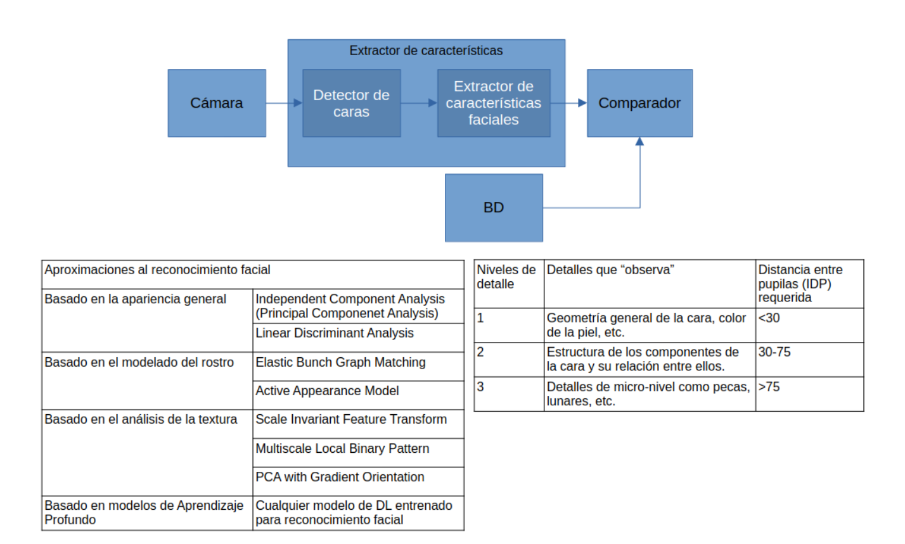

# CJAR: sistema biométrico de reconocimiento facial

Práctica de biometría: un sistema de reconocimiento facial que sigue este esquema.



```
Cámara/Foto → Detector de caras → Extractor de características → Comparador
                                                                     ↑
                                                         BD (database.csv)
```

**Inicio rápido** (solo hace falta Docker):

```bash
git clone <URL_NUEVA>
cd CJAR
docker compose up --build        # interfaz web en http://localhost:8765
```

La BD ya viene con las personas inscritas (`database/database.csv`), así que el sistema se puede usar nada más clonarlo.

## 1. Qué estamos haciendo

| Módulo | Archivo | Qué hace |
|---|---|---|
| Detector | `src/detector.py` | Localiza la cara principal de la foto con InsightFace (modelo `buffalo_s`) y la alinea a 112x112 px con sus 5 puntos faciales |
| Extractor | `src/extractor.py` | Convierte la cara en un *template*: un vector de 512 números (ArcFace), normalizado a norma 1 |
| Comparador | `src/matcher.py` | Similitud coseno entre templates. Si es `>= 0.48` (umbral) se considera la misma persona |
| Explicador | `src/explicador.py` | Trazabilidad: dice en qué zonas de la cara (ojos, nariz, boca...) se apoya el parecido entre dos caras, tapando cada zona y midiendo cuánto cae la similitud (análisis por oclusión) |
| BD | `src/database.py` | Guarda los templates en `database/database.csv` con columnas `id,template` (los 512 valores separados por `;`) |
| Utilidades | `src/utils.py` | Acepta la foto como ruta, bytes o array de NumPy (JPEG, PNG, WebP, AVIF...), y el template como array, lista o texto. Rechaza entradas maliciosas (NaN, infinitos, vectores de ceros, dimensión distinta de 512) |

La clase principal es `BiometricSystem` (`src/biometric_system.py`) y tiene los **9 métodos** que pide el enunciado:

| Flujo | Inscribir | Verificar (1:1) | Identificar (1:N) |
|---|---|---|---|
| Completo (foto → detector → extractor → comparador) | `inscribir(id, foto)` | `verificar(id, foto)` | `identificar(foto)` |
| Sin detector (`_sd`, la foto va directa al extractor) | `inscribir_sd(id, foto)` | `verificar_sd(id, foto)` | `identificar_sd(foto)` |
| Sin detector ni extractor (`_t`, se pasa el template) | `inscribir_t(id, t)` | `verificar_t(id, t)` | `identificar_t(t)` |

- `inscribir*` → `True`/`False` (guarda o actualiza la persona en la BD). `inscribir` e `inscribir_sd` aceptan también una **lista de fotos**: se promedian sus templates y se guarda la media, que reconoce mejor otros ángulos y luces. Si alguna foto no es válida, no se inscribe nada.
- `verificar*` → `True`/`False` (¿esta foto/template es de la persona `id`?)
- `identificar*` → `id` o `None` (¿de quién es esta foto/template?)
- En `_sd` la foto debe ser ya una cara recortada (idealmente alineada, 112x112); si no, se redimensiona tal cual.
- En `_t` el template es un vector de 512 floats (array de NumPy, lista o texto con los valores separados por `;`). Se normaliza a norma 1 antes de usarlo.

> **Ningún método lanza excepciones:** ante datos corruptos o ataques devuelve `False` o `None`.

Defensas de entrada (`src/utils.py`):

- **Templates:** exactamente 512 números finitos; la norma se calcula en float64 para que valores enormes (p. ej. `1e30`) no desborden y acaben guardados como un vector de ceros. Textos y listas demasiado largos se rechazan antes de convertirlos.
- **Fotos:** máximo 30 MB y 40 megapíxeles, comprobado en la cabecera antes de decodificar (evita las "bombas" de imagen, ficheros de pocos KB que declaran 50000x50000 px). Arrays con NaN, infinitos o tipos no numéricos se rechazan.
- **Identificadores:** sin caracteres de control (saltos de línea, nulos), máximo 128 caracteres y sin empezar por `=`, `+`, `-` o `@` (inyección de fórmulas al abrir el CSV con Excel).

La web (`web/app.py`) añade: solo responde en `localhost`, exige la cabecera `X-CJAR` en las peticiones que cambian datos (otra web abierta en el navegador no puede inscribir ni borrar), envía cabeceras de seguridad (CSP sin scripts en línea, sin iframes), limita el tamaño de las peticiones, no publica la documentación de la API y vuelve a codificar las fotos que guarda (sin metadatos ni contenido oculto). Además: inscribir, borrar, listar personas y ver sus fotos exige la clave de administración; el cálculo pesado no bloquea el servidor y, si hay demasiadas peticiones en cola, responde 503. El contenedor corre sin root, con el sistema de ficheros de solo lectura, sin capacidades y con límites de CPU, memoria y procesos; las dependencias, la imagen base y los modelos (SHA-256) están fijados. La BD falla en modo cerrado si no se puede leer y serializa las escrituras entre procesos.

> Explicación visual del funcionamiento completo, etapa por etapa: [`docs/workflow.html`](docs/workflow.html) (ábrelo en el navegador).

## 2. Estructura del proyecto

```
├── src/                Módulos del sistema (ver sección 1)
├── tests/              Tests de funcionamiento y de ataques
├── web/                Interfaz web (FastAPI + página HTML)
├── database/
│   └── database.csv    BD oficial con las personas inscritas
├── docs/               Esquema y explicación visual del pipeline
├── main.py             Demo por terminal (usa una BD aparte, no toca la oficial)
├── cargar_dataset.py   Regenera la BD a partir de las fotos
├── requirements.txt    Dependencias de Python
├── Dockerfile          Imagen de Docker del sistema
└── docker-compose.yml  Arranque automático con Docker
```

## 3. Cómo ejecutarlo con Docker (recomendado)

```bash
docker compose up --build
```

Esto, automáticamente:

1. Construye la imagen (Python 3.11 + dependencias).
2. Descarga los modelos de InsightFace dentro de la imagen (solo la primera vez; tarda unos minutos).
3. Arranca la **interfaz web** en **http://localhost:8765** (solo accesible desde tu ordenador).

### Usuario del contenedor y permisos de `database/` y `fotos/`

El contenedor **no corre como root**: usa por defecto el usuario `1000:1000` (el usuario `cjar` de la imagen), con la raíz de solo lectura. Para poder inscribir y borrar, ese usuario tiene que poder escribir en `database/` (y en `fotos/` para las fotos de inscripción). Si esas carpetas son de otro usuario de tu equipo (típico en Linux), hay dos opciones:

```bash
chown 1000:1000 database fotos                                   # opción 1: cambiar el propietario
CJAR_UID=$(id -u) CJAR_GID=$(id -g) docker compose up --build    # opción 2: ejecutar con tu usuario
```

**`CJAR_UID` no debe ser 0:** con 0 el contenedor correría como root (se conservan `cap_drop: ALL`, `no-new-privileges` y la raíz de solo lectura, pero `database/` y `fotos/` serían escribibles por root); Compose no lo impide ni lo avisa.

La opción 2 también se puede dejar fija en un fichero `.env` junto al `docker-compose.yml` (`CJAR_UID=...` y `CJAR_GID=...`; Compose también lee de él `CJAR_ADMIN_TOKEN`). Ese `.env` **está ignorado por git (`.gitignore`) y por Docker (`.dockerignore`)**, y además la imagen ya no copia toda la carpeta del proyecto sino solo `src/`, `web/`, `tests/`, `docker/` y unos pocos ficheros por nombre, así que no se sube al repositorio ni entra en la imagen. Aun así, trátalo como un secreto: no lo compartas ni lo pegues en un issue. Se ha probado con el uid 1000 y con el 2000 (con `database/` y `fotos/` propiedad de ese uid y la raíz de solo lectura): carga los modelos y puede inscribir, verificar, identificar y borrar. Si el directorio no es escribible, el sistema **no se para**: lo avisa en el log al arrancar con la solución (`docker compose logs cjar`). Si es `database/`, las inscripciones devolverán `False`. Si solo es `fotos/`, la web **inscribe igualmente** a la persona (la plantilla es lo que cuenta), no guarda su foto y lo avisa con un `WARNING` en el log y un aviso en pantalla; la respuesta de `/api/inscribir` lleva `foto_guardada: false`.

### Avisos en el log

`BiometricSystem` sigue sin lanzar nunca excepciones (devuelve `False` o `None`), pero cada fallo deja un `WARNING` en el logger `cjar` con el método, el tipo de excepción y el mensaje de la excepción **tratado por `limpiar()`** (`src/registro.py`). En la web salen en `docker compose logs cjar`. Un resultado normal (id inexistente, sin coincidencia) no es un fallo y no se registra. Desde Python basta con `import logging; logging.basicConfig()` para verlos.

**Qué hace `limpiar()` con el mensaje de la excepción:** lo recorta a 500 caracteres antes de cualquier expresión regular; lo deja en una sola línea (colapsa saltos de línea y espacios); sustituye por `?` los caracteres de control (ESC, NUL, retroceso, DEL…); sustituye por `…` lo que va entre comillas; sustituye por `<num>` los números decimales, los de notación científica y `nan`/`inf`; y recorta el resultado a 200 caracteres.

**Qué NO se garantiza:** que el log no contenga datos. Pasan tal cual los números enteros y hexadecimales, cualquier texto que no vaya entre comillas (un token, una clave), las **rutas de ficheros** (p. ej. `No existe el archivo de imagen en la ruta: /home/ana/pasaporte.jpg`), el nombre del método, el tipo de excepción y los ids de las personas. Unas comillas mezcladas dentro de un mismo texto (`ab'cd"ef`) pueden dejar pasar un fragmento. La clave de administración no llega al logging por ningún camino que se conozca, pero `limpiar()` no la censura. Las fotos y las plantillas no se registran como tales, solo el mensaje de la excepción. Si vas a compartir un log, revísalo antes.

Al leer `database.csv` se registra un resumen por cada **cambio real** del fichero (no por petición): filas válidas y descartadas, ids duplicados (gana la última fila) y, si el número de personas baja respecto a la lectura anterior, un aviso de posible truncado o borrado. Es un `INFO` si todo está bien y un `WARNING` si hay filas descartadas, duplicados o una bajada.

### Interfaz web

| Pestaña | Qué hace |
|---|---|
| **Inscribir** | Registra a una persona con un id y **una o varias fotos** (subidas, arrastradas o hechas con la cámara). Con varias guarda la media e indica si alguna foto no encaja con las demás |
| **Verificar 1:1** | Dice si una foto es de la persona indicada (solo sí/no) y, si lo es, en qué zonas de la cara se parece |
| **Identificar 1:N** | Dice de quién es una foto si alguien supera el umbral (sin ranking) y en qué se parece |
| **Comparar** | Similitud entre dos fotos subidas, sin tocar la BD, y en qué zonas se parecen |
| **Base de datos** | Lista las personas inscritas y permite borrarlas (con la clave de administración) |

Arriba se elige el flujo (**Completo** o **Sin detector `_sd`**; verificar e identificar usan siempre el completo) y se escribe la **clave de administración**, necesaria para inscribir, borrar y ver la lista de personas y sus fotos. La clave se fija con la variable `CJAR_ADMIN_TOKEN` (mín. 16 caracteres) o, si no se define, se genera al arrancar y aparece en `docker compose logs cjar`. El umbral es siempre el del sistema (0.48) y no se puede cambiar desde la web.

**Clave de administración.** Se define con la variable `CJAR_ADMIN_TOKEN`, que debe ser **solo ASCII** (con otros caracteres nunca autentica: el servidor la compara en UTF-8 con una cabecera que llega decodificada como latin-1) y de **al menos 16 caracteres aleatorios**. El servidor solo comprueba la longitud, no la entropía, y no limita los intentos: una clave corta o predecible se puede adivinar. Una forma de generarla: `python -c "import secrets; print(secrets.token_urlsafe(24))"`. Ejemplo de uso:

```bash
CJAR_ADMIN_TOKEN=una-clave-larga-y-secreta docker compose up --build
```

Si no se define (o es demasiado corta), el servidor genera una al arrancar (`secrets.token_urlsafe(24)`, 192 bits) y la muestra en el log del contenedor: `docker compose logs cjar` (línea «Clave de administración de CJAR»), **donde queda escrita en claro** para cualquiera que pueda leer ese log. **Esa clave cambia en cada arranque.** Si no quieres que quede en el log, define `CJAR_ADMIN_TOKEN` tú mismo. Se pega en el campo «Clave de administración» de la web (se guarda solo en esa pestaña del navegador). Sin ella se puede verificar, identificar y comparar, pero no inscribir, borrar ni listar personas ni ver sus fotos.

**Por seguridad, verificar e identificar no devuelven la similitud ni un ranking**: con esa cifra un atacante podría ir retocando una imagen hasta parecerse a alguien (*hill-climbing*). Un id que no existe responde igual que uno que no coincide. Inscribir un id que ya existe pide confirmación antes de sustituirlo. Si una inscripción haría superar los topes de la BD (100.000 filas o 64 MB, los mismos que rechaza la lectura), no se escribe nada: la biblioteca devuelve `False` (con un aviso en el log) y la web responde **507**, distinto del 409 de «ya inscrito».

**¿En qué se parecen?** En Comparar, y en Verificar e Identificar cuando hay coincidencia, aparece además un desglose por zonas de la cara (frente, ojos, nariz, mejillas, boca, mentón) y un mapa de calor. Como los 512 valores de ArcFace no se pueden interpretar uno a uno, se usa *análisis por oclusión* (`src/explicador.py`): se tapa cada zona, se vuelve a extraer el template y se mide la similitud de nuevo. Lo que se pierde es el aporte de esa zona: positivo (verde) = se parecen ahí; negativo (rojo) = esa zona los diferencia. Si hay foto de las dos personas se hace en los dos sentidos y se promedia. Añade ~1-2 s por petición en CPU.

La carpeta `database/` está montada como volumen, así que los cambios en la BD se guardan en tu ordenador. El código (`src/`, `web/`, `tests/`) también está montado: si lo cambias, basta con `docker compose restart`, sin reconstruir la imagen.

### Uso desde Python

Mete las fotos en `fotos/` (se monta en `/app/fotos` dentro del contenedor) y abre una consola con `docker compose run --rm cjar python`:

```python
>>> from src.biometric_system import BiometricSystem
>>> s = BiometricSystem()                       # usa database/database.csv
>>> s.identificar("fotos/una_foto.jpg")
'keanu_reeves'
>>> s.verificar("keanu_reeves", "fotos/una_foto.jpg")
True
>>> s.inscribir("ana", ["fotos/ana1.jpg", "fotos/ana2.jpg"])
True
>>> t = s.db.get_template("ana")                # template de 512 floats
>>> s.verificar_t("ana", t), s.identificar_t(t)
(True, 'ana')
```

**`inscribir`, `inscribir_sd` e `inscribir_t` no sustituyen a una persona que ya existe.** Si el id ya está inscrito devuelven `False` y no tocan nada, salvo que se pase `reemplazar=True`. Es una **decisión consciente**: si reinscribir sustituyera la plantilla, cualquiera podría inscribir su cara con el id de otra persona y pasar a ser esa persona (en la versión anterior pasaba, y `verificar` aceptaba al atacante y rechazaba a la víctima). Si lo que quieres es actualizar a alguien, pídelo explícitamente:

```python
>>> s.inscribir("ana", "fotos/ana3.jpg")                      # «ana» ya existe: no se sustituye
False
>>> s.inscribir("ana", "fotos/ana3.jpg", reemplazar=True)     # sustituirla a propósito
True
```

`False` significa también cualquier otro fallo (foto sin cara, id no válido...): el motivo queda en el log (ver «Avisos en el log»). `cargar_dataset.py` usa `reemplazar=True` porque recargar el dataset es decisión del operador.

Otros comandos útiles:

```bash
docker compose run --rm cjar python main.py                              # demo por terminal
docker compose run --rm cjar python -m unittest tests.test_system -v     # tests de la librería
docker compose build                                                     # tras cambiar requirements.txt
```

**Tests de la web y de los avisos.** `tests/test_web.py` y `tests/test_avisos.py` usan `fastapi.testclient`, que necesita `httpx2`; la imagen normal no lo trae. Para lanzar toda la suite (sin red) construye la imagen con las dependencias de desarrollo:

```bash
docker build --build-arg INSTALL_DEV=1 -t cjar-biometria:test .
docker run --rm --network none cjar-biometria:test \
    python -m unittest tests.test_system tests.test_web tests.test_avisos tests.test_despliegue -v
```

**Los tests no tocan tus datos** (usan directorios temporales; comprobado sembrando `database/` y `fotos/` con ficheros «reales»: la suite no cambia ninguno). Una sola cosa queda: al importarse, `web/app.py` abre `database/database.csv` (y lo crea con la cabecera si falta) y crea `fotos/` si no existe. Por eso lanza la suite con el `docker run` de arriba (no monta nada) y **no con `docker compose run`, que monta tu `database/` y tu `fotos/`**, salvo que sean copias.

## 4. Cómo ejecutarlo sin Docker

Usar **Python 3.11** (insightface puede no compilar en versiones muy nuevas):

```bash
python3.11 -m venv .venv
source .venv/bin/activate        # en Windows: .venv\Scripts\activate
pip install -r requirements.txt
uvicorn web.app:app --port 8765 --no-server-header   # interfaz web
python main.py                           # demo
python -m unittest tests.test_system -v  # tests
```

La primera ejecución descarga los modelos en `~/.insightface`.

## 5. Base de datos

`database/database.csv` contiene las personas inscritas con el sistema completo (detector + extractor):

- Las personas del dataset común proporcionado por el docente, una foto cada una. El id es el nombre del fichero sin el año (`christian_bale_2012.jpg` → `christian_bale`).
- La persona elegida por el equipo: **`salman_rushdie`**, inscrito con la media de 3 fotos.

Las fotos **no** se suben al repositorio (`fotos/` está en `.gitignore`), solo los templates. Para regenerar la BD desde las fotos:

```bash
# fotos del docente en fotos/Dataset/, fotos de la persona extra en fotos/salman_rushdie/
docker compose run --rm cjar python cargar_dataset.py --extra salman_rushdie fotos/salman_rushdie/salman_rushdie_1.jpg fotos/salman_rushdie/salman_rushdie_2.jpg fotos/salman_rushdie/salman_rushdie_3.jpg
```

Si una persona ya existe, `inscribir` (y `inscribir_sd`, `inscribir_t`) **no** la sustituye y devuelve `False`, salvo que se llame con `reemplazar=True` (`cargar_dataset.py` lo hace, porque recargar el dataset es decisión del operador). Los tests y `main.py` trabajan sobre BDs temporales y no modifican la oficial.

## 6. Limitaciones conocidas

Lo que **no se puede resolver** con lo que exige el enunciado (la BD es legible por el grupo rival y los métodos `_t` reciben la plantilla tal cual). Las pruebas se hicieron con la BD oficial (50 personas) y el umbral 0,48.

**a) Con el CSV público, `verificar_t` e `identificar_t` aceptan la plantilla robada.** `verificar_t('adam_pearson', <su fila del CSV>)` devuelve `True` e `identificar_t` devuelve su id. Es inherente al enunciado: la BD es legible por el grupo rival y los métodos `_t` reciben la plantilla tal cual. La web nunca acepta plantillas. Las plantillas manipuladas (NaN, infinitos, ceros, dimensión errónea, tipos raros) se rechazan; una con valores enormes como 1e30 se normaliza, pero no coincide con nadie.

**b) `verificar_sd` acepta entradas sintéticas.** Una búsqueda evolutiva ingenua, con acceso al extractor y a la plantilla pública (sin ninguna foto de la víctima), llegó a **0,482 de similitud con el umbral en 0,48** tras 5.792 evaluaciones del extractor en unos 7 minutos (421 s, 2 CPU), con una imagen que **no es una cara** (un patrón de manchas de colores); `verificar_sd` la aceptó y el flujo completo con detector la rechazó. No se probó una búsqueda con gradientes del modelo ni una que genere una cara realista, así que no se sabe cuánto más lejos llegaría. No hay detección de vivacidad: con una foto pública de la víctima, `verificar` y `verificar_sd` la aceptan. En cambio, 300 imágenes de ruido aleatorio no superaron 0,256 contra ninguna de las 50 plantillas, y la similitud máxima entre dos personas distintas de la BD oficial es 0,355.

**c) Editar el CSV a mano no se detecta con firma.** Añadir una fila nueva, sustituir en el sitio la plantilla de otra persona, duplicar un id (gana la última fila; la víctima deja de verificarse), truncar el fichero (con la mitad de los bytes quedaban 25 de 50 personas) o borrarlo (la BD queda vacía) no lo impide ni lo detecta ninguna firma. Con los avisos del log al menos queda constancia de algunos casos: filas descartadas, ids duplicados y la bajada del número de personas (truncado o borrado). **Añadir o sustituir una identidad bien formada, sin duplicar el id, no produce ningún aviso.**

**d) `_sd` espera una cara ya alineada de 112×112.** Con la foto completa sin alinear, `verificar_sd` da `False` incluso para la propia persona (similitud 0,265 de `adam_pearson` consigo mismo). Para usar `_sd` hay que pasar la cara que devuelve `detector.detect_and_align`.


